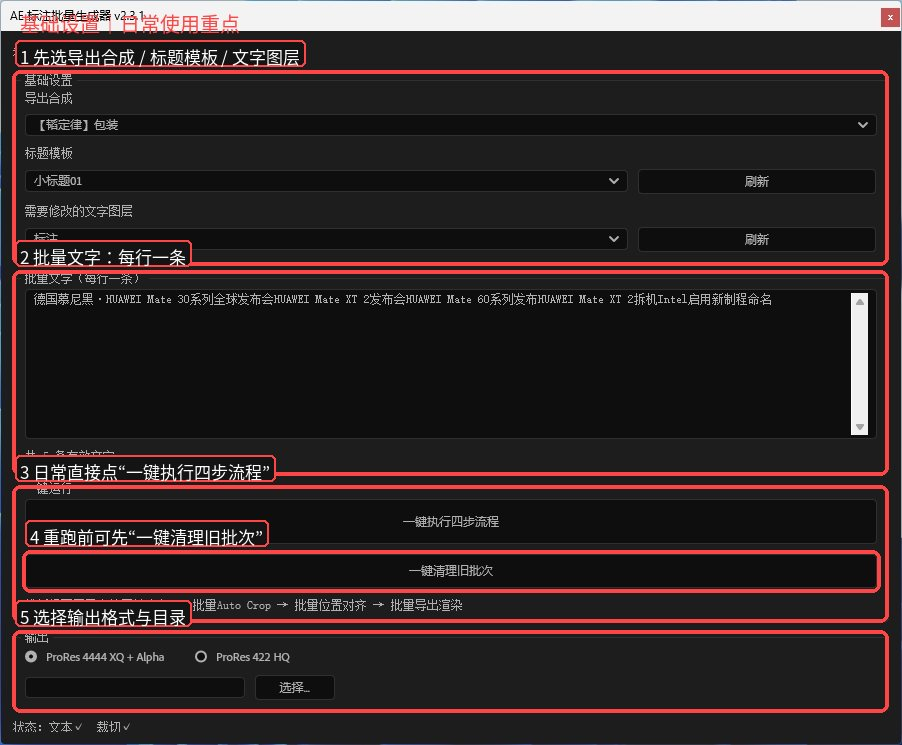
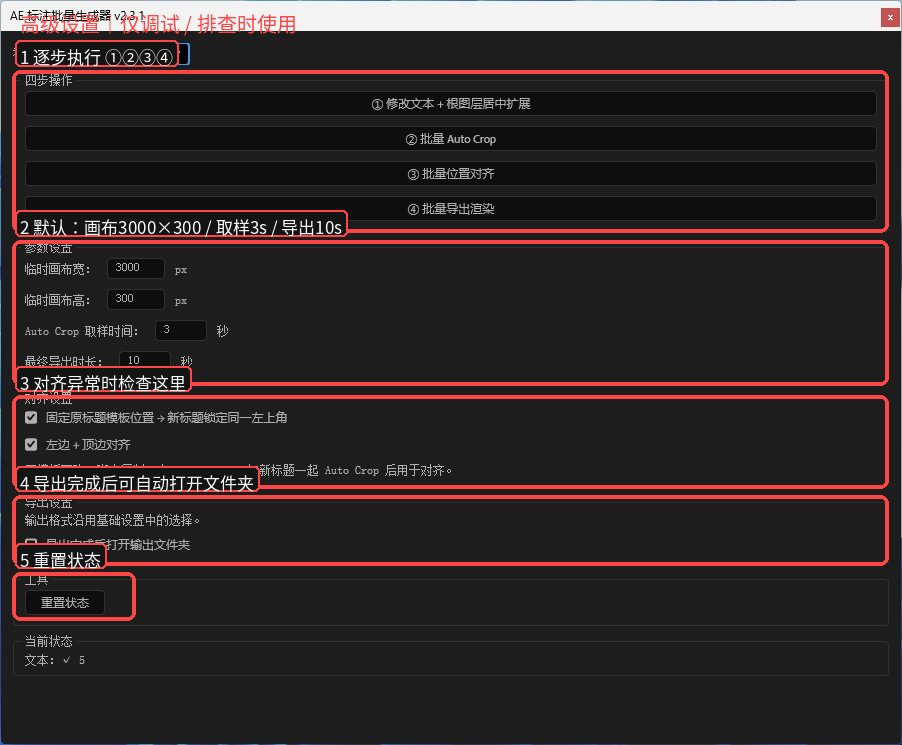

# AE 标注批量生成器 v2.3.1

> 三面板布局修复版。日常使用主要看「基础设置」；遇到问题再进入「高级设置」逐步排查。

## 基础设置



### 日常使用顺序

1. **导出合成**：选择最终用于放置标题并渲染的合成。
2. **标题模板**：选择本次需要批量修改的标题合成。
3. **需要修改的文字图层**：指定标题模板里真正要替换文字的 Text Layer。
4. **批量文字**：每行输入一条标题。
5. **一键执行四步流程**：自动完成改字、Auto Crop、位置对齐和批量导出。
6. **一键清理旧批次**：重新生成或测试失败时，先清理上一批临时内容。
7. **输出**：选择输出格式并设置输出目录。

正常情况下，只需要使用这一页。

## 高级设置



一键流程某一步结果不正确时，可以进入高级设置逐步检查：

1. **① 修改文本 + 根图层居中扩展**
2. **② 批量 Auto Crop**
3. **③ 批量位置对齐**
4. **④ 批量导出渲染**

默认参数：

- 临时画布：`3000 × 300`
- Auto Crop 取样时间：`3 秒`
- 最终导出时长：`10 秒`

标题位置异常时，重点检查「对齐设置」。

## 安装

将：

`AE标注批量生成器_v2.3.1.jsx`

复制到 After Effects 的 ScriptUI Panels 目录，例如：

```text
C:\Program Files\Adobe\Adobe After Effects 2025\Support Files\Scripts\ScriptUI Panels\
```

重启 After Effects 后：

```text
窗口 → AE 标注批量生成器 v2.3.1
```

## 使用前准备

- Adobe After Effects
- 已安装并可正常使用 Auto Crop
- AE 中可以正常执行 `图层 → Auto Crop`
- 如需对应输出格式，请提前保存好输出模块模板

## v2.3.1

- 基础设置 / 模板适配器 / 高级设置三面板结构
- 修复切换面板时出现大面积空白的问题
- 基础设置增加「一键清理旧批次」
- 保留批量改字、Auto Crop、对齐、导出核心流程

> 这一版 README 暂不放模板适配器教程，先展示稳定的基础流程和高级排查流程。
