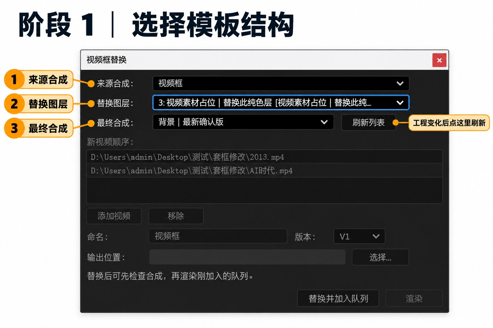
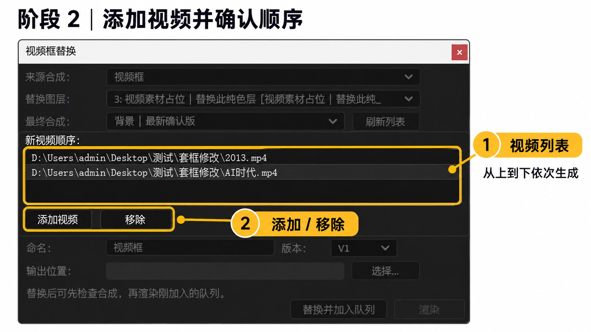
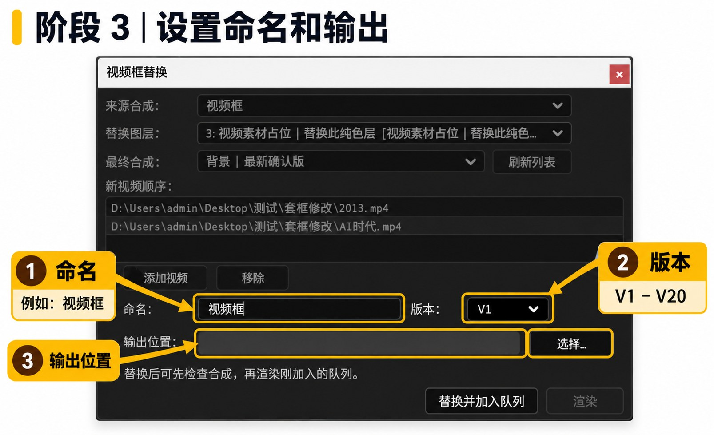
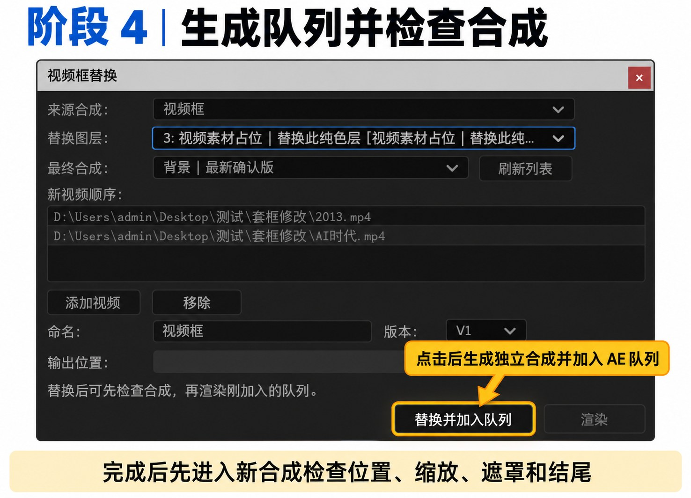
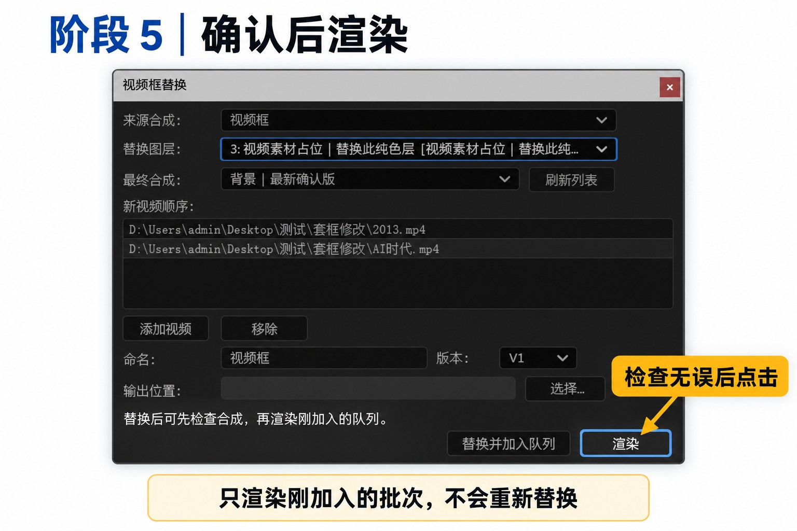

# 基地视频框替换

用于 Adobe After Effects 的可停靠批量替换面板。它会把多条视频依次替换到同一个模板位置，为每条视频生成独立的最终合成，递归同步导出链路中的合成与可见图层时长，再加入 AE 渲染队列。确认画面后，可把刚加入的批次发送到 Adobe Media Encoder 渲染。

当前脚本版本：`2026.10.19.1`

## 文件说明

- `视频框替换.jsx`：需要安装到 After Effects 的面板脚本。
- `docs/完整使用说明.md`：从安装、操作到交付的完整教程。
- `docs/模板配置与设置明细.md`：模板结构、三类占位层、时长与渲染设置说明。
- `docs/常见问题与排错.md`：警告、渲染、时间范围及兼容性问题处理。
- `docs/版本与验证记录.md`：版本、校验值与测试范围。

## 三分钟上手

1. 关闭 After Effects。
2. 把 `视频框替换.jsx` 复制到：

   ```text
   C:\Users\你的Windows用户名\AppData\Roaming\Adobe\After Effects\版本号\Scripts\ScriptUI Panels\
   ```

   例如 AE 2025 对应 `25.0`，AE 2026 对应 `26.0`。`AppData` 默认是隐藏文件夹，请先在资源管理器中打开“查看 → 显示 → 隐藏的项目”。
3. 启动 AE，在“编辑 → 首选项 → 脚本与表达式”中启用“允许脚本写入文件和访问网络”。
4. 打开模板工程，从“窗口 → 视频框替换”打开面板，并把它拖入工作区停靠。
5. 依次选择“来源合成”“替换图层”“最终合成”。
6. 点击“添加视频”，按列表顺序加入视频。
7. 填写命名并选择版本。默认命名为 `视频框`，选择 `V1` 时会生成：

   ```text
   视频框1_v1
   视频框2_v1
   视频框3_v1
   ```

8. 选择输出位置，点击“替换并加入队列”。
9. 进入生成的合成检查位置、缩放、遮罩和结尾。
10. 检查无误后回到面板点击“渲染”。脚本只发送刚加入的批次，不会再次替换。

## 分阶段操作图

### 阶段 1：选择模板结构

依次选择来源合成、替换图层和最终合成。工程中的合成发生变化时，点击“刷新列表”。



### 阶段 2：添加视频并确认顺序

点击“添加视频”，确认列表顺序。脚本会从上到下依次生成；选错时选中该行并点击“移除”。



### 阶段 3：设置命名、版本和输出位置

填写命名前缀，选择 V1–V20 版本号，然后选择本批次输出文件夹。



### 阶段 4：生成队列并检查合成

点击“替换并加入队列”。完成后先进入新合成检查位置、缩放、遮罩、装饰和结尾。



### 阶段 5：确认后渲染

检查无误后点击“渲染”。该按钮只渲染刚加入的批次，不会重新替换视频。



## 使用前必须确认

- 替换位置应是视频素材层、二维形状层或二维文字层。
- 推荐先把新模板人工或借助 AI 适配好，再用本脚本做日常批量。
- 从来源合成到最终合成的主嵌套路径不能启用时间重映射、倒放或无效时间伸缩。
- 使用轨道遮罩时建议 AE 23.0 或更高版本。
- Adobe Media Encoder 需要安装，并至少成功启动过一次。
- 脚本不会硬编码编码器；格式、编码和质量由 AE/AME 当前预设决定。

完整规则请阅读 [完整使用说明](docs/完整使用说明.md)。


